  
  
  
  
  
  

  <b>Open to mentoring.</b> Reach me via
  <!-- TODO owner: add LinkedIn / email links here, e.g. <a href="...">LinkedIn</a> · <a href="mailto:...">Email</a> · -->
  <a href="https://github.com/0xCryp7icX">GitHub</a>

Most of my work lives in private repos. I'm happy to give a walkthrough or a sanitised demo on request.
