  

<!-- TODO owner (do not ship brackets): add a name/role line and a contact link (LinkedIn / email) here, then delete this comment. -->

[GitHub profile](https://github.com/0xCryp7icX)

Tools for security training, cloud & AI security study, computer-vision classification, AI-narrated video and browser games.

## What I build

- **Secure-by-Design Trainer**: interactive security training (security · Rust/TS)
- **Cloud & AI Security Study**: exam-prep dashboard and drills (cloud · JS)
- **Structure Vision**: construction photo classifier (AI/ML · web)
- **Video Explainer Engine**: AI-voiced collage reels (AI · Python)
- **Puzzle Game**: browser geometry puzzle (game · TS)
- **Portfolio Lab**: UI prototypes (frontend · Next.js)

**Currently exploring:** AI security and cloud security.

> Most of my work lives in private repos. I'm happy to give a walkthrough or a sanitised demo on request.
